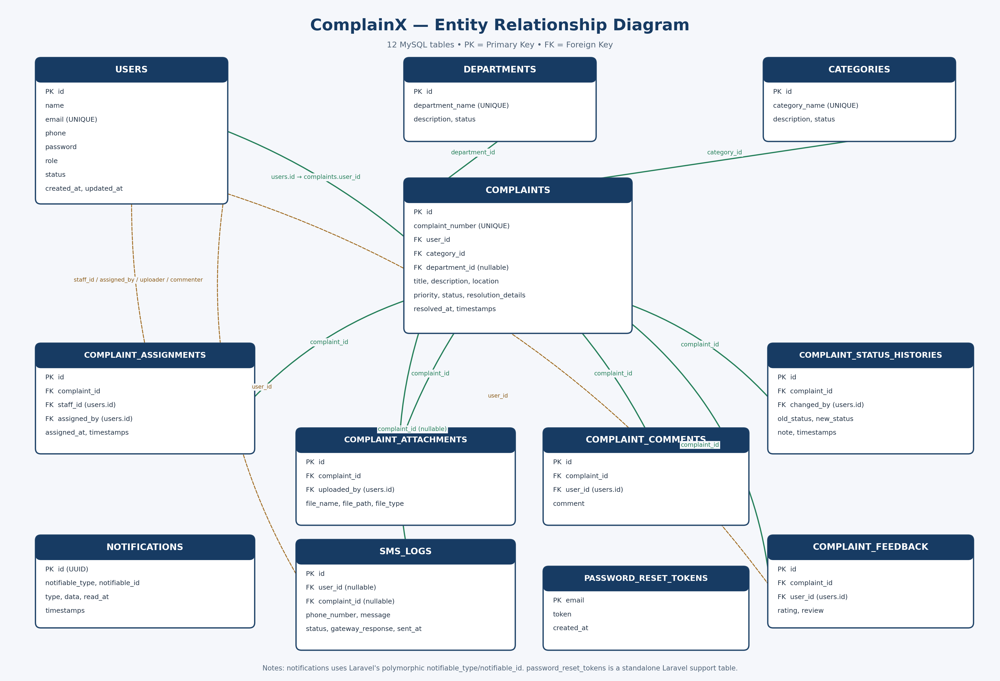

# ComplainX
### Online Complaint & Grievance Management System

ComplainX is a web-based complaint management platform. It allows users to submit complaints online, track progress, communicate with assigned staff, receive web and SMS notifications, and provide feedback after resolution.

## Project Overview

| Item | Details |
|---|---|
| Project Name | ComplainX |
| Project Type | Online Complaint & Grievance Management System |
| Backend | Laravel (PHP) |
| Database | MySQL |
| Frontend | HTML, CSS, Bootstrap 5, JavaScript |
| Template Engine | Laravel Blade |
| Notification | Web Notification + SMS Gateway |
| Project Level | Intermediate |

## Main Objectives

- Make complaint submission and tracking easier.
- Help administrators manage departments, categories, users, and staff.
- Assign complaints to the appropriate staff members.
- Track complaint status and keep a history of updates.
- Notify users through the website and SMS.
- Collect feedback and prepare reports.

## User Roles

### 1. Admin
- Manage users and staff.
- Manage departments and complaint categories.
- Review complaints and assign staff.
- Monitor complaint status and SMS logs.
- View feedback, reports, and dashboard statistics.

### 2. Staff
- View complaints assigned by the admin.
- Update work progress and complaint status.
- Add comments and resolution details.
- Upload supporting files where required.

### 3. General User
- Register and log in.
- Submit complaints with details and attachments.
- Track complaint status and view complaint history.
- Receive website and SMS notifications.
- Submit feedback and ratings after resolution.

## Main Features

- Authentication and role-based access.
- Admin, Staff, and User dashboards.
- User and staff management.
- Department and category management.
- Complaint submission with unique complaint number.
- Complaint priority and status management.
- Staff assignment and reassignment.
- Complaint comments and file attachments.
- Complaint status history and tracking.
- Website notifications.
- SMS gateway integration and SMS logs.
- Feedback and rating.
- Search, filtering, and reports.

## Entity Relationship Diagram (ERD)

The diagram below shows the 12 planned database tables and their main relationships.

**Database tables (12):**

1. `users`
2. `departments`
3. `categories`
4. `complaints`
5. `complaint_assignments`
6. `complaint_attachments`
7. `complaint_comments`
8. `complaint_status_histories`
9. `complaint_feedback`
10. `notifications`
11. `sms_logs`
12. `password_reset_tokens`

**Relationship notes:**
- One user can submit many complaints.
- One category can be linked to many complaints.
- One department can handle many complaints.
- A complaint can have multiple assignments, attachments, comments, status-history records, and SMS log records.
- A complaint can have one feedback record per user.
- `notifications` uses Laravel's polymorphic notification structure (`notifiable_type` and `notifiable_id`).
- `password_reset_tokens` is a Laravel support table and does not have a foreign-key relationship to the other tables.

## Technology Stack

- PHP
- Laravel
- MySQL
- HTML5
- CSS3
- Bootstrap 5
- JavaScript
- Blade
- Git and GitHub

## Planned Development Roadmap

1. Environment setup and Laravel installation.
2. Project configuration and Bootstrap layout.
3. Database design, migrations, models, and relationships.
4. Authentication and role-based middleware.
5. Admin dashboard.
6. User and staff management.
7. Department and category management.
8. Complaint submission and management.
9. Staff assignment.
10. Complaint tracking and status history.
11. Comments and attachments.
12. Web notifications and SMS gateway integration.
13. Feedback, reports, and PDF export.
14. Testing, bug fixing, and documentation.

## Installation (Development)

1. Install PHP, Composer, Node.js, and a local MySQL environment such as Laragon.
2. Create or open the Laravel project folder.
3. Configure the database credentials in the `.env` file.
4. Install PHP dependencies with `composer install`.
5. Install frontend dependencies with `npm install`.
6. Run database migrations with `php artisan migrate`.
7. Start the Laravel development server with `php artisan serve`.

> Important: The project is planned to use Laravel migrations as the source of truth for database structure. Do not import the standalone SQL schema and then run migrations that create the same tables. Choose one database setup method during development and keep migrations synchronized with the final schema.

## SMS Integration

SMS notifications will be sent through a third-party SMS gateway API. API credentials must be stored securely in environment configuration and must not be committed to GitHub. SMS delivery requires an active gateway account and available SMS balance. The `sms_logs` table will store message status and gateway response details.

## Project Status

**Status:** Development planned / in progress.

## Author

ComplainX Project
